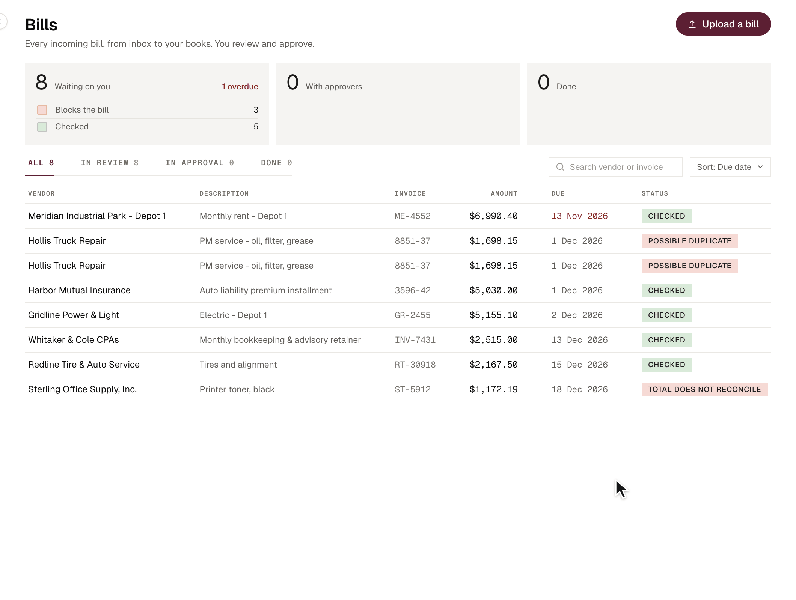
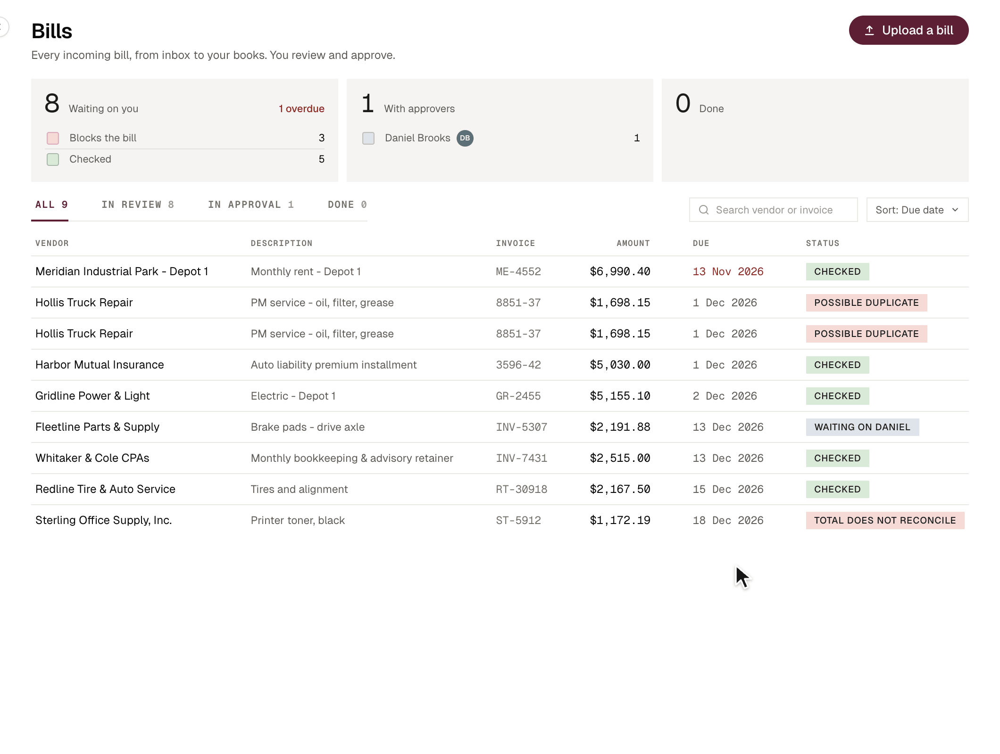
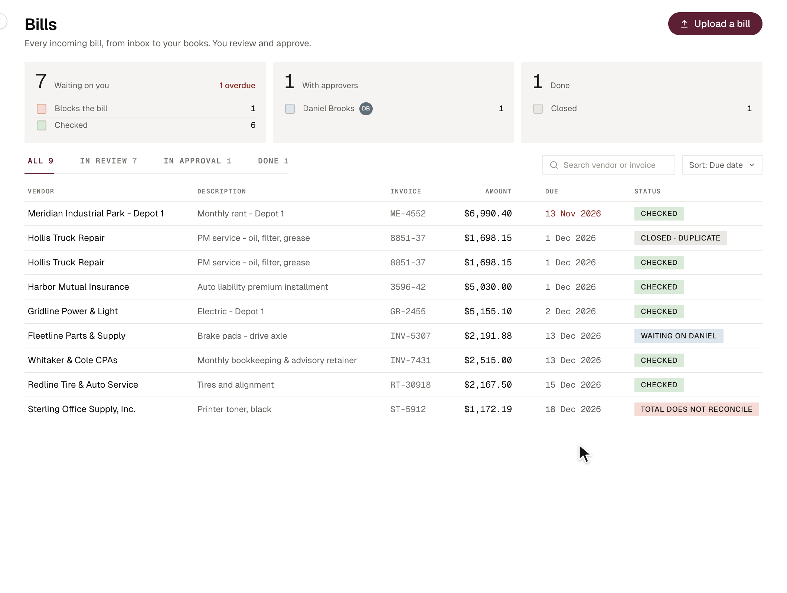
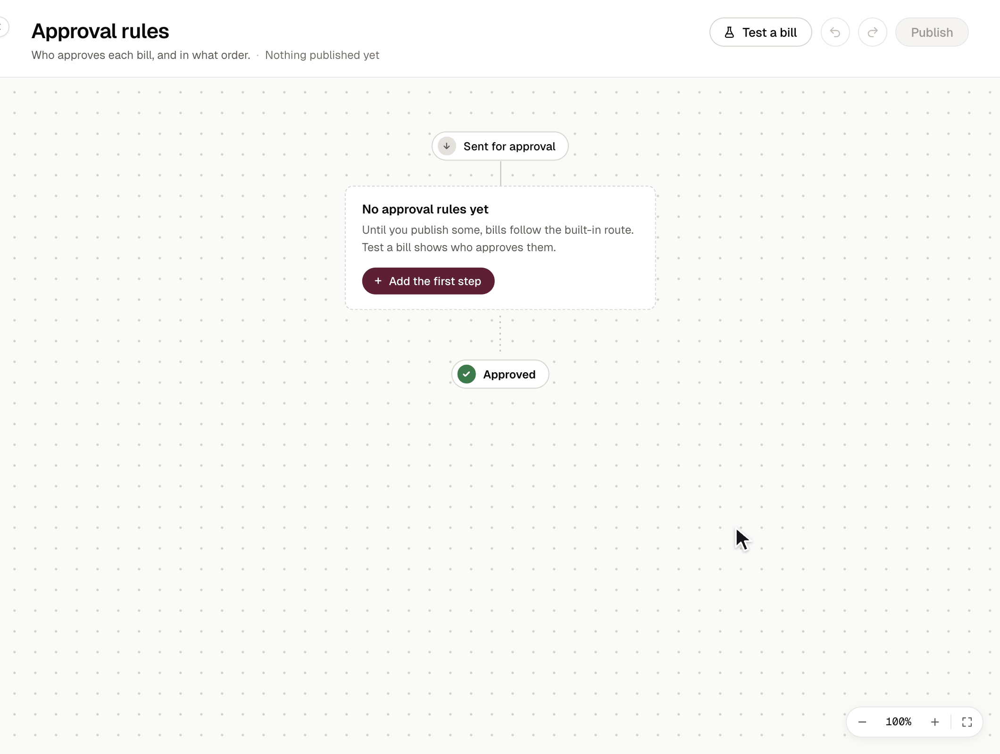
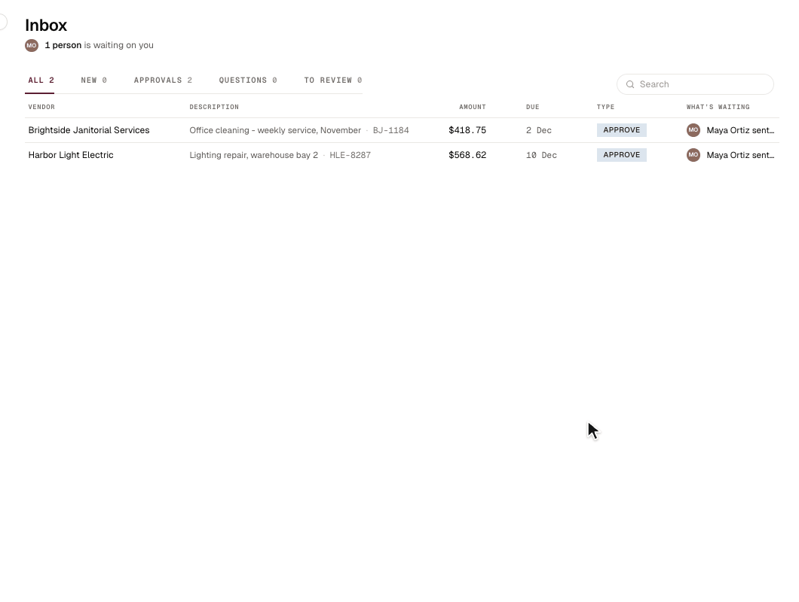
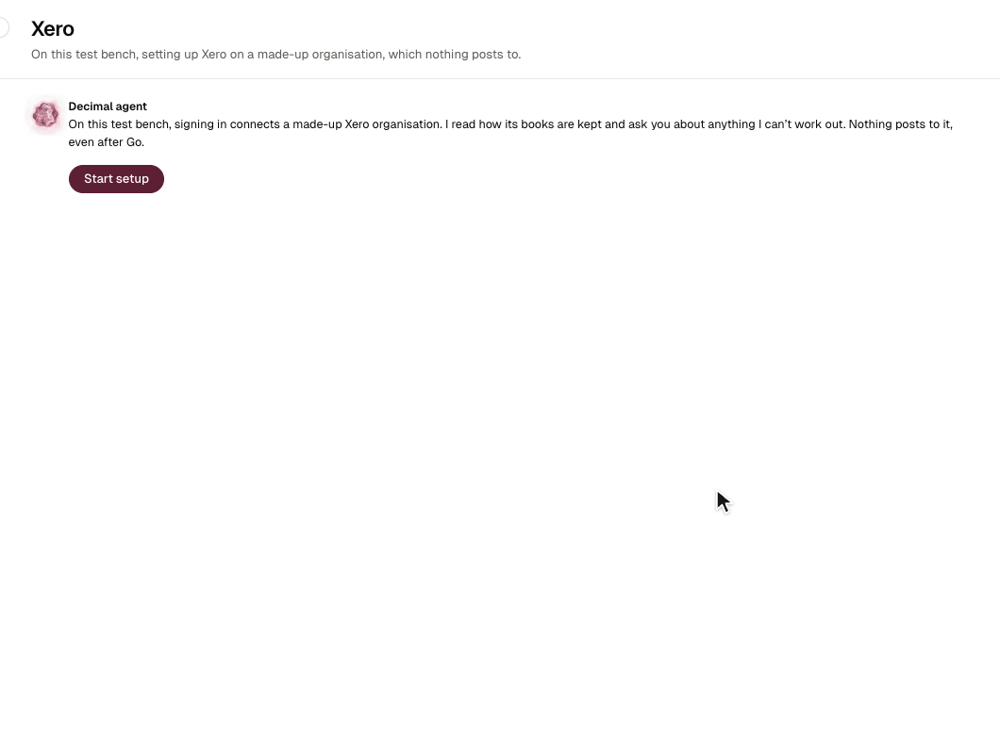

# Decimal

Accounts payable with agents built into the work. Decimal reads each bill, flags what looks wrong and posts it to QuickBooks or Xero. A person checks every bill, and nothing reaches the books until it's approved.

## A bill comes in

Upload a PDF or forward the email, and Decimal reads it as you watch. Click a figure to see where on the page it came from. Decimal says what it isn't sure of: here, the categories, since this is the vendor's first bill.

## A duplicate is caught

An agent compares the two bills figure by figure, reads both documents and recommends what to do. Closing the copy is still a person's click.

7 synthetic pairs, three runs: 21 of 21 verdicts right.

## Figures that don't add up

An agent reads the document to find out why: here, a freight charge the reading left off. Code checks every figure it names before the correction is offered.

6 synthetic cases, three runs: every answer that came back was right.

## Who approves what

Admins draw the rules: split by amount, vendor, Category or a vendor's first bill, and put people on each path.

## Approved means it's in the books

The last approval posts the bill to QuickBooks or Xero with the invoice attached. This one went to Xero's Demo Company.

## Connect your books

Setup is a conversation. Decimal reads 24 months of the books and asks about what it found: look-alike vendors, lines coded two ways, the closing date. Nothing posts until an admin presses Go.

18 scripted setups on made-up companies: 15 to 17 of 18 right on QuickBooks over five runs, 13 to 17 of 18 on Xero over three.

---

**Status.** Everything up to posting to the books is built. Paying the bill isn't built yet, and there is no hosted version. The GIFs were recorded on a made-up company with synthetic invoices.

**More.** Where the AI stops, how each agent was measured and what isn't built: [docs/HOW-IT-WORKS.md](docs/HOW-IT-WORKS.md). How the system is built: [docs/ARCHITECTURE.md](docs/ARCHITECTURE.md).

TypeScript, Express, PostgreSQL and React. Every AI call runs on Claude or OpenAI, Claude Haiku 5.5 by default.

Built by Zaid Khan ([@fuyofulo](https://github.com/fuyofulo)).
